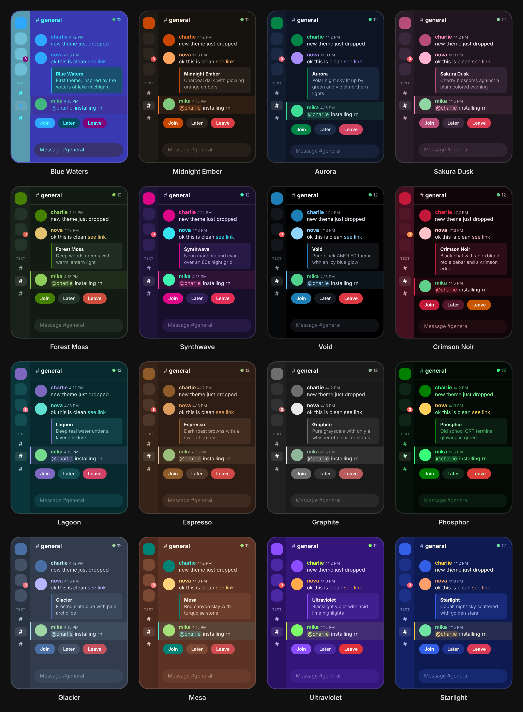

# iOSDiscordThemes
Themes for Bunny/BT Loader and Kettu Discord Tweaks

## Themes

| Theme | Description |
| --- | --- |
| [Blue Waters](Blue%20Waters.json) | First theme, inspired by the waters of lake michigan |
| [Midnight Ember](Midnight%20Ember.json) | Charcoal dark with glowing orange embers |
| [Aurora](Aurora.json) | Polar night sky lit up by green and violet northern lights |
| [Sakura Dusk](Sakura%20Dusk.json) | Cherry blossoms against a plum colored evening |
| [Forest Moss](Forest%20Moss.json) | Deep woods greens with warm lantern light |
| [Synthwave](Synthwave.json) | Neon magenta and cyan over an 80s night grid |
| [Void](Void.json) | Pure black AMOLED theme with an icy blue glow |
| [Crimson Noir](Crimson%20Noir.json) | Black chat with an oxblood red sidebar and a crimson edge |
| [Lagoon](Lagoon.json) | Deep teal water under a lavender dusk |
| [Espresso](Espresso.json) | Dark roast browns with a swirl of cream |
| [Graphite](Graphite.json) | Pure grayscale with only a whisper of color for status |
| [Phosphor](Phosphor.json) | Old school CRT terminal glowing in green |
| [Glacier](Glacier.json) | Frosted slate blue with pale arctic ice |
| [Mesa](Mesa.json) | Red canyon clay with turquoise stone |
| [Ultraviolet](Ultraviolet.json) | Blacklight violet with acid lime highlights |
| [Starlight](Starlight.json) | Cobalt night sky scattered with golden stars |

## Installing

Open a theme file, tap **Raw**, copy the URL, and paste it into the Themes page of your client.

The preview image is a mockup, not a screenshot of the app.
